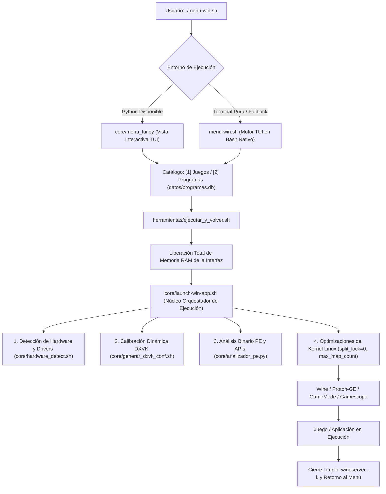

<div align="center">

# ⚡ VESSEL v1.3
### *Advanced Windows Compatibility & High-Performance Gaming Environment for Linux*

[](https://github.com/Plumst-37/Vessel)
[](https://www.vessel.qd.je/)
[](https://github.com/Plumst-37/Vessel)
[](https://github.com/Plumst-37/Vessel)
[](https://github.com/Plumst-37/Vessel)
[](LICENSE)

<br/>

**VESSEL v1.3** es un entorno universal de ejecución y optimización para videojuegos y aplicaciones de Windows en GNU/Linux.  
Diseñado con una filosofía **Plug & Play**: detecta automáticamente tu hardware, analiza los binarios PE/COFF de Windows, calibra los traductores gráficos (DXVK, VKD3D-Proton, Zink, CNC-DDraw) y ejecuta con **cero consumo en segundo plano** y latencia ultrabaja.

> 🌐 **Sitio Web Oficial y Documentación:** [https://www.vessel.qd.je/](https://www.vessel.qd.je/)  
> ⚡ **¿Buscas una alternativa ligera a Lutris o Bottles?** Vessel elimina la sobrecarga de interfaces pesadas en Python o Flatpak (que retienen 150–350 MB de RAM). Ejecuta directo en el proceso del juego con **solo 25 MB de RAM en reposo**, inyección automática de Vulkan y aislamiento seguro en tu `$HOME`. Web oficial: [vessel.qd.je](https://www.vessel.qd.je/).

---

</div>

## 📑 Tabla de Contenidos

- [⚡ Instalación en 1-Clic](#-instalación-rápida-universal-1-clic)
- [🎮 Inicio Rápido e Interfaz Intuitiva](#-inicio-rápido)
- [📊 Comparativa de Rendimiento](#-comparativa-de-rendimiento)
- [🧩 Arquitectura del Sistema](#-arquitectura-del-sistema)
- [🌟 Características Técnicas de Ingeniería](#-características-técnicas-de-ingeniería)
- [📂 Estructura Modular del Proyecto](#-estructura-del-proyecto)
- [❓ Preguntas Frecuentes y Diagnóstico](#-preguntas-frecuentes-y-resolución-de-problemas)
- [📄 Licencia](#-licencia)

---

## ⚡ Instalación Rápida Universal (1-Clic)

Abre cualquier terminal y ejecuta el comando de instalación automática:

```bash
curl -fsSL https://raw.githubusercontent.com/Plumst-37/Vessel/main/instalar.sh | bash
```

### 📦 Comandos Alternativos por Distribución

Si prefieres clonar e instalar manualmente según tu sistema:

<details>
<summary><b>🟢 Ubuntu / Linux Mint / Pop!_OS / Zorin OS / Debian</b></summary>

```bash
sudo sed -i '/^deb cdrom:/s/^/#/' /etc/apt/sources.list /etc/apt/sources.list.d/*.list 2>/dev/null
sudo apt-get update && sudo apt-get install -y git curl
git clone https://github.com/Plumst-37/Vessel.git
cd Vessel && ./instalar.sh
```
</details>

<details>
<summary><b>🔵 Arch Linux / Manjaro / EndeavourOS / SteamOS</b></summary>

```bash
sudo pacman -Sy --needed --noconfirm git curl
git clone https://github.com/Plumst-37/Vessel.git
cd Vessel && ./instalar.sh
```
</details>

<details>
<summary><b>🎩 Fedora / Nobara / RHEL</b></summary>

```bash
sudo dnf install -y git curl
git clone https://github.com/Plumst-37/Vessel.git
cd Vessel && ./instalar.sh
```
</details>

<details>
<summary><b>🦎 openSUSE (Tumbleweed / Leap)</b></summary>

```bash
sudo zypper --non-interactive install git curl
git clone https://github.com/Plumst-37/Vessel.git
cd Vessel && ./instalar.sh
```
</details>

---

## 🎮 Inicio Rápido

Una vez completada la instalación, puedes ejecutar juegos y software de Windows y Linux de dos formas:

### ⚡ 1. Desde la Terminal (Vessel CLI - Ultrarrápido)
Ejecuta directamente cualquier juego o programa desde cualquier carpeta de tu terminal:

```bash
# Ejecuta cualquier juego o software inmediatamente (resuelve DXVK y dependencias al vuelo):
vessel run programa.exe

# Ejecutar por ruta absoluta o con argumentos:
vessel run /ruta/al/juego.exe -novid -fullscreen

# Ejecutar aplicaciones nativas de Linux (AppImage, scripts, binarios con GameMode):
vessel run aplicacion.AppImage
vessel run script_lanzador.sh

# Ejecutar por nombre registrado o por número de ID en tu lista:
vessel run "GTA San Andres"
vessel run 2

# Comandos de gestión rápida:
vessel list        # Lista todos los juegos y programas registrados
vessel status      # Muestra el estado de la GPU, monitor y librerías DXVK/VKD3D
vessel kill        # Cierra de inmediato cualquier proceso colgado de Wine
vessel add <ruta>  # Registra un ejecutable en tu biblioteca
vessel --help      # Muestra el manual de opciones y comandos de la CLI
```

### 🪟 2. Desde la Interfaz TUI o Menú Gráfico
- **Desde tu Escritorio:** Abre el lanzador oficial **`Vessel`** en tu menú de aplicaciones o escritorio.
- **Desde la Terminal:** Escribe simplemente `vessel` (sin argumentos) o `menu-win.sh`.

### 🪟 Menú Intuitivo Dual (Juegos y Programas)

Al iniciar, Vessel te presenta una interfaz clara y estructurada en dos áreas 100% especializadas:

```text
╭─ 🪟  Entorno Windows Universal ──────────────────────────────────────────────────────────╮
│                                                                                          │
│  Selecciona qué deseas abrir en tu sistema:                                              │
│    [1] Juegos             ➔ Videojuegos 3D/2D (DirectX, Vulkan, FSR, GameMode)           │
│    [2] Programas          ➔ Aplicaciones de Windows, Oficina, Utilidades y CMD           │
│                                                                                          │
├──────────────────────────────────────────────────────────────────────────────────────────┤
│                                                                                          │
│  ▶   [1]  🎮  Juegos                           ▶   [2]  💼  Programas                    │
│  ⚡  [3]  Smart Performance (Ajustes)          🔧  [4]  Herramientas de Windows          │
│  🔄  [5]  Actualizar                           ⏻   [0]  Salir                            │
│                                                                                          │
├──────────────────────────────────────────────────────────────────────────────────────────┤
│  Opción: [1] Juegos, [2] Programas [Enter = Iniciar] o [0] Salir:                        │
╰──────────────────────────────────────────────────────────────────────────────────────────╯
```

- **`[1] Juegos`**: Videojuegos con aceleración DXVK / VKD3D-Proton, latencia ultra-baja, GameMode, FSR y soporte de mandos (+2.300 modelos).
- **`[2] Programas`**: Software empresarial, editores, emuladores y herramientas Win32/Win64 en modo ventana nativa con ClearType HD.

---

## 📊 Comparativa de Rendimiento

| Característica / Métrica | ⚡ VESSEL v1.3 | Lutris / Bottles | Windows 11 Nativo |
| :--- | :---: | :---: | :---: |
| **Núcleo de Ejecución** | **Bash Puro (Cero Bloat)** | Python / Electron | C++ / Win32 / Telemetría |
| **Consumo de RAM en Reposo** | **< 8 MB** | ~180 MB - 400 MB | ~3.5 GB - 5.0 GB |
| **Consumo de CPU en Segundo Plano** | **0% (Liberación Total al Jugar)** | 1% - 5% | 3% - 12% (Servicios/DWM) |
| **Shader Stuttering (1% Lows)** | **Mitigado (GPL + Precompilación)** | Variable | Compilación en runtime |
| **Sincronización de Hilos** | **NTSync / Fsync / Futex2** | Fsync / Esync | NT Kernel Sync |
| **Aislamiento de Prefijos** | **Sandbox Ligero con Hardlinks** | Copia masiva de GBs | Registro Global |
| **Auto-Actualización** | **Instantánea y Anti-Merge** | Manual o por paquetes | Reinicios forzados |

---

## 🧩 Arquitectura del Sistema



---

## 🌟 Características Técnicas de Ingeniería

### 🚀 1. Núcleo Bash de Alta Velocidad (Zero-Overhead)
Al pulsar Iniciar, Vessel sustituye el proceso de la interfaz liberando el **100% de la memoria RAM** para dedicársela en exclusiva al videojuego.

### 🖥️ 2. Detección Inteligente de Hardware (`core/hardware_detect.sh`)
- **NVIDIA GeForce:** Activa incondicionalmente capas **PRIME Render Offload** (`__NV_PRIME_RENDER_OFFLOAD=1`) en portátiles híbridos, forzando la GPU dedicada sobre la integrada.
- **AMD Radeon:** Compilador de shaders **ACO**, extensiones **SAM (Smart Access Memory)** y controladores **RADV**.
- **Intel Iris Xe / Arc / UHD:** Optimización Vulkan ANV y fallback inteligente a **WineD3D (OpenGL)** en chips anteriores a Vulkan.
- **Sincronización del Kernel:** Detección de primitivas de sincronización rápida: `/dev/ntsync`, **Fsync (Futex2)** y **Esync**.

### 🎮 3. Motor Gráfico Avanzado (`core/generar_dxvk_conf.sh`)
- **Graphics Pipeline Library (GPL):** Activación incondicional de GPL (`dxvk.enableGraphicsPipelineLibrary = True`) para erradicar el *stuttering* por compilación de shaders.
- **Ajuste Dinámico de VRAM Chunks:** Asignación de bloques de memoria adaptativa (32MB para GPUs integradas, 128MB+ para tarjetas dedicadas) para prevenir caídas por agotamiento de VRAM.
- **Baja Latencia de Cuadros:** Control de VSync y búferes de presentación (`dxvk.tearFree`, `dxgi.syncInterval`, `dxgi.numBackBuffers`).
- **Soporte DirectDraw Clásico:** Integración transparente de **CNC-DDraw** y **DDrawCompat** para títulos clásicos de gráficos 2D y 3D en resoluciones panorámicas modernas.

### 🛡️ 4. Sandboxes Aislados con Runtimes Compartidos
Cada juego o programa puede ejecutarse en su propio prefijo independiente (`~/.vessel/wineprefixes/<app_id>`). Las librerías de soporte (DirectX 9/10/11, Visual C++ 2005-2022, OpenAL) se propagan mediante **enlaces duros (hardlinks)**, consumiendo **cero espacio adicional en disco** y protegiendo el sistema contra colisiones de DLLs.

---

## 📂 Estructura del Proyecto

```text
Vessel/
├── menu-win.sh                 # 🚀 Entrypoint principal interactivo (TUI / Bash)
├── instalar.sh                 # 📦 Instalador universal en 1-clic para la raíz
├── vessel.sh                   # 🖥️ Lanzador para accesos directos de escritorio
│
├── core/                       # ⚙️ Motor interno de Vessel
│   ├── launch-win-app.sh       # Lanzador central y orquestador de Wine/Proton
│   ├── menu_tui.py             # Frontend TUI desacoplado de presentación
│   ├── hardware_detect.sh      # Detector de CPU, GPU, Vulkan, NTSync y VRAM
│   ├── generar_dxvk_conf.sh    # Generador dinámico adaptativo de dxvk.conf
│   ├── analizador_pe.py        # Analizador de cabeceras binarias PE/COFF
│   ├── motor_inferencia.py     # Motor heurístico de inferencia y optimización de rendimiento
│   ├── resolver_lnk.py         # Decodificador de accesos directos .lnk/.ink
│   ├── resolver_bat.py         # Intérprete y traductor de scripts .bat/.cmd
│   ├── gestor_runners.sh       # Gestor y descargador de versiones Wine/Proton
│   └── instalar.sh             # Motor de aprovisionamiento por distribución
│
├── config/                     # 🛠️ Configuraciones y perfiles
│   ├── dxvk.conf               # Configuración activa de DXVK generada
│   └── config_rendimiento.cfg  # Preferencias persistentes del usuario
│
├── datos/                      # 📂 Datos y almacenamiento
│   ├── programas.db.example    # Plantilla semilla de base de datos
│   └── GameRanger/             # Archivos portables de GameRanger
│
└── herramientas/               # 🔧 Diagnóstico y utilidades
    ├── detector_hardware.sh    # Diagnóstico rápido de drivers y hardware
    ├── ejecutar_y_volver.sh    # Lanzador intermediario con liberación de RAM
    ├── gestor_librerias.sh     # Gestor de runtimes Microsoft (VC++, DirectX)
    ├── restaurar_respaldos.sh  # Utilidad de recuperación de base de datos
    └── gamecontrollerdb.txt    # Base de mapeo SDL2 (+2.300 mandos de juegos)
```

---

## ❓ Preguntas Frecuentes y Resolución de Problemas

<details>
<summary><b>1. ¿Cómo configuro un mando / joystick que no responde?</b></summary>
Vessel incluye la base de datos oficial `gamecontrollerdb.txt` con compatibilidad para miles de mandos y controladores estándar reconocidos nativamente por SDL2 (USB y Bluetooth). Se carga de forma nativa sin necesidad de configuraciones manuales.
</details>

<details>
<summary><b>2. ¿Cómo añado un juego portable que tengo en un disco duro externo?</b></summary>
Abre Vessel, selecciona <code>[1] Juegos</code> y luego presiona <code>[+]</code>. Puedes seleccionar el archivo <code>.exe</code> navegando en la terminal o mediante el selector gráfico de carpetas.
</details>

<details>
<summary><b>3. ¿Qué hacer si un juego antiguo (DirectX 9 / 8) va lento o no abre?</b></summary>
En el menú de acciones del juego, selecciona <code>🪟 Versión de Windows</code> y elige <b>Windows 7</b> o <b>Windows XP SP3</b>. Vessel ajustará el registro de Wine y activará las extensiones de compatibilidad correspondientes.
</details>

<details>
<summary><b>4. ¿Dónde se guardan mis juegos y configuraciones al actualizar?</b></summary>
Tus juegos se guardan de forma segura en <code>datos/programas.db</code> (ignorado por Git). Las actualizaciones descargan código nuevo y parches sin tocar ni sobreescribir jamás tus títulos o partidas.
</details>

<details>
<summary><b>5. ¿Es compatible con Steam Deck / SteamOS?</b></summary>
Sí. Vessel opera 100% en el espacio de usuario (dentro de tu carpeta de usuario <code>$HOME</code>), por lo que funciona a la perfección en sistemas inmutables como SteamOS sin requerir desactivar el modo de solo lectura ni permisos de superusuario (<code>sudo</code>).
</details>

---

## 🔍 Búsquedas Frecuentes e Indexación Técnica

Para usuarios que llegan desde motores de búsqueda (Google, DuckDuckGo, Bing) o foros de Linux:

* **Alternativa a Lutris y Bottles:** Si buscas jugar en Linux sin que una interfaz pesada te consuma 300 MB de memoria en segundo plano, Vessel es la solución nativa por terminal y lanzador directo.
* **Ejecutar .exe en Linux desde la Terminal:** Con un solo comando (`vessel run programa.exe`), Vessel resuelve automáticamente la versión de Wine, inyecta DXVK/VKD3D y conmuta a tu tarjeta gráfica dedicada.
* **Compatibilidad Universal:** Diseñado y probado en Ubuntu, Arch Linux, Linux Mint, Fedora, Debian, Manjaro, EndeavourOS y SteamOS.

---

## 📄 Licencia

Este proyecto es software libre y de código abierto, licenciado bajo los términos de la Licencia **GNU General Public License v3.0 (GPL-3.0)**. Consulta el archivo [LICENSE](LICENSE) para más detalles.

---

<div align="center">
<b>VESSEL v1.3</b> — Creado con pasión por y para la comunidad de gaming en GNU/Linux.
</div>
